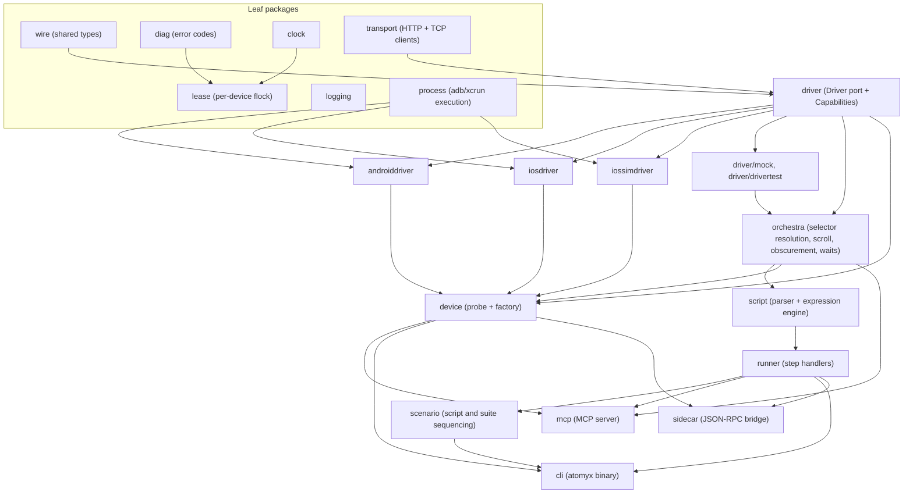

# Atomyx: Architecture reference

## Purpose

Who reads this: a contributor or AI agent about to design or evaluate
a change to the driver, orchestra, script, MCP, or CLI layers.

When to read it: before adding a Driver method, a script step, an
MCP tool, or a new platform adapter, and before judging whether a
change respects the module's dependency direction.

What this does not cover: concrete file locations (see
[`repo-map.md`](./repo-map.md)), build and test commands (see
[`development.md`](./development.md)), and the MCP tool-by-tool
contract (see [`tools.md`](./tools.md)).

## TL;DR

Atomyx's runtime is a single Go module (`dev.atomyx`) under `core/`.
One platform-neutral `Driver` port abstracts device control. Four
implementers satisfy it (mock, Android, iOS device, iOS simulator).
An `Orchestra` layer composes `Driver` calls into selector
resolution, scroll-into-view, obscurement handling, and wait
primitives, so every higher layer inherits that behavior for free.
The script engine and the MCP server are both built on `Orchestra`,
never on a `Driver` directly. Dependency direction between all of
this is enforced by `go-arch-lint` reading `core/.go-arch-lint.yml`,
run locally through `make check`.

## Layers



Reading the diagram: an arrow means "the arrow's tail may depend on
its head." `mcp`, `cli`, and `sidecar` are parallel consumers of the
same `orchestra` and `runner` contracts, and none of them wraps another.

## The Driver port

`core/internal/driver/driver.go` defines `Driver`, the platform-neutral
device control surface every concrete adapter implements. Port names
are platform-neutral by design: `Platform()` returns `"ios"` or
`"android"`, not a package name. `AppID` replaces a platform-specific
concept like a bundle identifier or a package name at the port
boundary.

A `Driver` implementation reports static feature support through
`Capabilities()` (`core/internal/driver/types.go`), which callers
above the port must check before invoking a conditionally supported
method:

- `CanEraseText`: native backward erase from the focused field.
- `CanHideKeyboard`: native keyboard dismissal.
- `CanWaitForIdle`: a native idle-detection primitive. `orchestra`
  falls back to tree-diff polling when absent.
- `CanMultiPointer`: multi-pointer gesture dispatch (pinch, rotate,
  multi-finger custom paths).
- `CanPressure`: per-waypoint pressure values inside a gesture.

Rule of thumb stated directly in the port's doc comment: if a method
can be implemented by composing other `Driver` methods, it does not
belong on the interface. Selector resolution, scroll-into-view,
obscurement detection, and retry all live one layer up, in
`orchestra`.

## The Orchestra layer

`core/internal/orchestra` composes `Driver` calls into the operations
every consumer (script engine, MCP tools, CLI) actually wants:
selector resolution and priority broadening, scroll-into-view via the
scroll controller (`core/internal/orchestra/scroll_controller.go`),
obscurement detection, and the wait primitives in
`core/internal/orchestra/wait.go`. The tree-query helpers live in
`core/internal/orchestra/finder.go`. `Find` and `FindOne` run a
compiled selector filter against a hierarchy and return matching
cursors.

### Selector priority broadening

`core/internal/orchestra/priority_broadening.go` defines
`CompileSelector`, which turns a `Selector` (the fields an agent or a
script step supplies) into an `ElementFilter`. Content fields are
tried in a fixed priority order, most specific to most fuzzy:

```
ID > Label > Text > Value > Hint
```

The first field that produces a non-empty match wins, so broadening
stops there. When the caller supplies `Text` but not `Label`, a
`Label` match against the same pattern is tried right after `Text`,
because a cross-platform text query against an element that only
carries an accessibility label still needs to resolve. `Role`,
`Enabled`, `Clickable`, and `Focused` are not part of the priority
chain: every candidate filter AND-s them in as constraints. `Nth`
skips ranking entirely and selects positionally from the winning
filter's result list.

This is the mechanism that lets an agent write `{text: "Login"}`
without knowing whether Android exposes that string through
`contentDesc` or iOS through `label`: both adapters normalize onto
the same canonical attribute keys at the `Driver` boundary, and
`CompileSelector` tries whichever fields the caller supplied in
priority order.

## Driver implementers

Four packages implement `Driver`, all verified against the same
contract suite in `core/internal/driver/drivertest`:

- **Mock** (`core/internal/driver/mock`): an in-memory implementation
  for tests. Production code must never import it. Only test files
  and the contract suite depend on it.
- **Android** (`core/internal/androiddriver`): talks to the Android
  agent's HTTP control server over `127.0.0.1:8765`, reached through
  an `adb forward` tunnel the driver manages.
- **iOS device and simulator via XCUITest**
  (`core/internal/iosdriver`): talks to the Swift XCUITest runner
  over a line-delimited JSON TCP protocol on `127.0.0.1:22087`.
  Connecting to a physical device additionally runs an `iproxy` USB
  tunnel to map that port.
- **iOS simulator via direct HID** (`core/internal/iossimdriver`):
  dispatches touch gestures through a WebSocket connection to a
  helper process wrapping Apple's private simulator HID client,
  bypassing XCUITest for the simulator-only fast path.

Each implementer's own package doc comment describes its transport in
more detail. The contract suite in `drivertest` is what keeps all
four honest against the same `Driver` invariants as the port
evolves.

## Script engine and step handlers

`core/internal/script` owns the test-script schema, the YAML parser,
and the expression engine (`core/internal/script/expression`) that
evaluates the boolean and arithmetic expressions used by
`assertExpr`, branch and handle conditions, and extract and capture
patterns. `core/internal/runner` defines the command execution
contract (`CommandContext`, `CommandResult`, `CommandDefinition`) and
the `ScriptRunner` that dispatches a parsed script's steps against
that contract, one step at a time, against an `Orchestra` instance,
failing fast on the first step that does not succeed.

`core/internal/scenario` sequences groups of scripts (a scenario) and
ordered sets of scripts or scenarios (a suite), giving each entry its
own fresh `ScriptRunner` so precondition, guard, and per-run data
isolation stay entirely inside `runner`.

## The MCP surface

`core/internal/mcp` builds the Atomyx MCP server: the stdio-based
process an AI agent connects to for tool-driven mobile test
orchestration. Every tool handler is a thin wrapper that validates
its arguments against a JSON Schema, calls one or more `Orchestra` (or,
for run and script tools, `RunStore` or `ScriptRunner`) methods, and
returns a JSON result. See [`tools.md`](./tools.md) for the full
tool-by-tool contract. MCP is an adapter over the same core the CLI
uses, and it never sits between the CLI and `Orchestra`.

## The CLI

`core/internal/cli` implements the `atomyx` binary: argument parsing,
command routing, and the driver module's commands (`run`, `suite`,
`list-devices`, `doctor`, `version`, `help`) plus the skills module's
commands (`init`, `update-skills`) that install the bundled skill and
agent markdown files from `core/internal/skills` into a consumer
project.

## Device lease and identity

`core/internal/lease` gives each physical device at most one driving
Atomyx process. A lease is an exclusive `flock` on a per-device lock
file in a per-user runtime directory. The kernel owns liveness: the
flock sits on an open descriptor for the process lifetime and
disappears when the process exits for any reason, so a crashed holder
never leaves a stale lock.

Contract:

- **Key.** The first 16 hex characters of the SHA-256 of
  `<platform>:<hardwareId>`. The files are `<key>.lock` and
  `<key>.sock`.
- **Runtime directory.** On Linux, `$XDG_RUNTIME_DIR/atomyx`. Elsewhere,
  a `run` subdirectory of the user cache directory. The per-user
  fallback `/tmp/atomyx-<uid>` replaces that choice when it is unset,
  when a socket path under it would exceed 104 bytes, or when its
  filesystem is not local (on macOS, not mounted with `MNT_LOCAL`). The
  directory is created with mode 0700, must be a real directory (not a
  symlink) owned by the current user, and otherwise the error is an
  `UnsafeDirError`.
- **Conflict.** `Acquire` retries a contended flock for about 200
  milliseconds, then returns a `HeldError` carrying `DEVICE_HELD` and
  the holder's display metadata. `DEVICE_BUSY` stays reserved for a
  foreign, non-Atomyx automation session, and the two codes never mean
  the same thing. `DEVICE_RELEASED_HELD` (an agent session that gave up
  its device and finds it held) and `RUN_EXPIRED` (a tool call on a run
  closed by the open-run idle timeout) are the other two codes the
  lease design defines, built by `diag.NewDeviceReleasedHeld` and
  `diag.NewRunExpired`.
- **Replacement check.** After the flock succeeds, the descriptor is
  compared with a fresh `stat` of the path, and a mismatch restarts the
  acquire a bounded number of times. `Lease.Recheck` repeats the
  comparison for a long-lived holder, and `Lease.Watch` runs it every
  `InodeRecheckPeriod` (5 seconds). A failed re-acquire returns an error
  wrapping `ErrLost`.
- **Lock file.** It is never unlinked. It carries the holder's
  `{pid, command, role, runId, socket, startedAt, idleSince}` for
  display only, and nothing reads that metadata to make a control
  decision.
- **Probe.** `Manager.Probe` takes the same real flock and releases it
  immediately. It never creates the lock file and never writes holder
  metadata.

Canonical identity lives in `core/internal/device/identity.go`.
`IdentityResolver.Resolve` runs before any agent connect, through
queries with no side effect on the device:

- Android: `ro.serialno` read through adb, so one phone reached over USB
  and over Wi-Fi maps to one lease. When `ro.serialno` is empty or a
  known generic value, the identity is the AVD name from
  `ro.boot.qemu.avd_name` joined with the adb serial. An unauthorized,
  offline or unavailable device returns a `DeviceStateError` instead of
  an empty serial.
- iOS: the UDID from the descriptor.

`lease` may depend only on `diag` and the common leaves. It does not
import `device`, so the caller resolves the identity first and passes
the key down.

## Dependency direction and its enforcement

Dependency direction across every package under `core/internal/` is
declared in `core/.go-arch-lint.yml` and enforced locally by
`go-arch-lint check --project-path .`, part of `make -C core check`
(see [`development.md`](./development.md) for the full gate list). The
config lists every package as a named component and an explicit
`mayDependOn` edge list, and an import that is not on that list fails
the check.

The shape the config encodes:

- **Leaf components** (`clock`, `logging`, `version`, `diag`, `wire`)
  carry no business knowledge and may be depended on by nearly
  everything, directly mirroring the "leaf package" language in their
  own doc comments.
- **`transport`** may depend only on `wire` and `diag`.
- **`lease`** may depend only on `diag` and the common leaves.
- **`driver`** may depend only on `wire` and `transport`. The three
  concrete implementers (`androiddriver`, `iosdriver`,
  `iossimdriver`) may depend on `driver`, `transport`, `process`, and
  the `drivertest` contract suite, but not on each other.
- **`orchestra`** may depend on `driver` and `drivermock` (for its own
  tests), never on a concrete implementer. This is what keeps
  `Orchestra` platform-neutral: it is compiled against the port, not
  against Android or iOS code.
- **`script`** depends on `driver` and `orchestra`.
- **`runner`** additionally depends on `script` and `expression`.
- **`scenario`** additionally depends on `runner`.
- **`device`** (discovery and construction) is the one package
  allowed to depend on `driver` and all three concrete implementers
  at once, because assembling a live `Driver` for whichever platform
  a caller selects is exactly its job.
- **`mcp`**, **`cli`**, and **`sidecar`** sit at the top: each may
  depend on `orchestra`, `script`, `runner`, `device`, and their own
  supporting leaves, but none of them may depend on each other. This
  is the enforcement mechanism behind "MCP, CLI, and the sidecar are
  parallel consumers, not stacked layers."
- **`conformance`** and **`cmd`** are declared `anyProjectDeps: true`:
  the differential test corpus and the binary entry points are
  allowed to import anything, because their job is exercising or
  wiring the rest of the module, not being depended upon.

A change that needs an edge the config does not grant is a signal to
reconsider the change's layer, not to add a blanket allowance.

## Design principles

These hold regardless of which layer a change touches:

- **Cross-platform by design.** Every capability an agent or a script
  step can invoke goes through the `Driver` port. Port and
  `Capabilities` field names are platform-neutral.
- **One tool per intent.** The MCP surface stays small on purpose;
  before adding a tool, confirm no existing tool can absorb the
  intent through a parameter.
- **No platform branching above the driver adapter.** `orchestra`,
  `script`, `runner`, and `mcp` never switch on `Platform()`. A
  behavior that genuinely differs per platform belongs inside the
  concrete `Driver` implementer, not in a conditional above it.
- **Selector-first, coordinates first-class.** Actions accept a
  `Selector` or raw `{x, y}` coordinates as an equally valid,
  non-hacky alternative, because not every element carries a stable
  selector.
- **Agent ergonomics over engine purity.** A tool name, error message,
  or default that makes the calling agent's life easier wins even
  when it pushes complexity into the tool layer that would otherwise
  "belong" lower in the stack.

## References

- [`repo-map.md`](./repo-map.md): where each package and binary lives
  on disk.
- [`development.md`](./development.md): build, test, and extension
  workflow, including running `go-arch-lint` locally.
- [`tools.md`](./tools.md): the full MCP tool contract.
