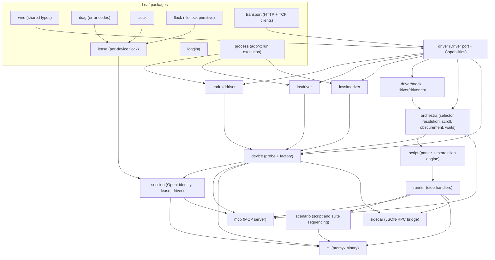

# Atomyx: Architecture reference

## Purpose

Who reads this: a contributor or AI agent about to design or evaluate
a change to the driver, orchestra, script, MCP, or CLI layers.

When to read it: before adding a Driver method, a script step, an
MCP tool, or a new platform adapter, and before judging whether a
change respects the module's dependency direction.

What this does not cover: concrete file locations (see
[`repo-map.md`](./repo-map.md)), build and test commands (see
[`development.md`](./development.md)), and the MCP tool-by-tool
contract (see [`tools.md`](./tools.md)).

## TL;DR

Atomyx's runtime is a single Go module (`dev.atomyx`) under `core/`.
One platform-neutral `Driver` port abstracts device control. Four
implementers satisfy it (mock, Android, iOS device, iOS simulator).
An `Orchestra` layer composes `Driver` calls into selector
resolution, scroll-into-view, obscurement handling, and wait
primitives, so every higher layer inherits that behavior for free.
The script engine and the MCP server are both built on `Orchestra`,
never on a `Driver` directly. Dependency direction between all of
this is enforced by `go-arch-lint` reading `core/.go-arch-lint.yml`,
run locally through `make check`.

## Layers



Reading the diagram: an arrow means "the arrow's tail may depend on
its head." `mcp`, `cli`, and `sidecar` are parallel consumers of the
same `orchestra` and `runner` contracts, and none of them wraps another.

## The Driver port

`core/internal/driver/driver.go` defines `Driver`, the platform-neutral
device control surface every concrete adapter implements. Port names
are platform-neutral by design: `Platform()` returns `"ios"` or
`"android"`, not a package name. `AppID` replaces a platform-specific
concept like a bundle identifier or a package name at the port
boundary.

A `Driver` implementation reports static feature support through
`Capabilities()` (`core/internal/driver/types.go`), which callers
above the port must check before invoking a conditionally supported
method:

- `CanEraseText`: native backward erase from the focused field.
- `CanHideKeyboard`: native keyboard dismissal.
- `CanWaitForIdle`: a native idle-detection primitive. `orchestra`
  falls back to tree-diff polling when absent.
- `CanMultiPointer`: multi-pointer gesture dispatch (pinch, rotate,
  multi-finger custom paths).
- `CanPressure`: per-waypoint pressure values inside a gesture.

Rule of thumb stated directly in the port's doc comment: if a method
can be implemented by composing other `Driver` methods, it does not
belong on the interface. Selector resolution, scroll-into-view,
obscurement detection, and retry all live one layer up, in
`orchestra`.

## The Orchestra layer

`core/internal/orchestra` composes `Driver` calls into the operations
every consumer (script engine, MCP tools, CLI) actually wants:
selector resolution and priority broadening, scroll-into-view via the
scroll controller (`core/internal/orchestra/scroll_controller.go`),
obscurement detection, and the wait primitives in
`core/internal/orchestra/wait.go`. The tree-query helpers live in
`core/internal/orchestra/finder.go`. `Find` and `FindOne` run a
compiled selector filter against a hierarchy and return matching
cursors.

### Selector priority broadening

`core/internal/orchestra/priority_broadening.go` defines
`CompileSelector`, which turns a `Selector` (the fields an agent or a
script step supplies) into an `ElementFilter`. Content fields are
tried in a fixed priority order, most specific to most fuzzy:

```
ID > Label > Text > Value > Hint
```

The first field that produces a non-empty match wins, so broadening
stops there. When the caller supplies `Text` but not `Label`, a
`Label` match against the same pattern is tried right after `Text`,
because a cross-platform text query against an element that only
carries an accessibility label still needs to resolve. `Role`,
`Enabled`, `Clickable`, and `Focused` are not part of the priority
chain: every candidate filter AND-s them in as constraints. `Nth`
skips ranking entirely and selects positionally from the winning
filter's result list.

This is the mechanism that lets an agent write `{text: "Login"}`
without knowing whether Android exposes that string through
`contentDesc` or iOS through `label`: both adapters normalize onto
the same canonical attribute keys at the `Driver` boundary, and
`CompileSelector` tries whichever fields the caller supplied in
priority order.

`core/internal/orchestra/selector_suggest.go` runs the same policy in
reverse: `SuggestSelectors` takes a tree and a node path (child indexes
from the root) and returns ranked candidate selectors for that node.
A candidate counts as unique only when `CompileSelector` against the
same tree resolves to the target and matches nothing else. Role and
state constraints are added only when they make an ambiguous candidate
unique, `Nth` is the last resort, and the text and value of a secure
node are never used.

## Driver implementers

Four packages implement `Driver`, all verified against the same
contract suite in `core/internal/driver/drivertest`:

- **Mock** (`core/internal/driver/mock`): an in-memory implementation
  for tests. Production code must never import it. Only test files
  and the contract suite depend on it.
- **Android** (`core/internal/androiddriver`): talks to the Android
  agent's HTTP control server over `127.0.0.1:8765`, reached through
  an `adb forward` tunnel the driver manages.
- **iOS device and simulator via XCUITest**
  (`core/internal/iosdriver`): talks to the Swift XCUITest runner
  over a line-delimited JSON TCP protocol on `127.0.0.1:22087`.
  Connecting to a physical device additionally runs an `iproxy` USB
  tunnel to map that port.
- **iOS simulator via direct HID** (`core/internal/iossimdriver`):
  dispatches touch gestures through a WebSocket connection to a
  helper process wrapping Apple's private simulator HID client,
  bypassing XCUITest for the simulator-only fast path.

Each implementer's own package doc comment describes its transport in
more detail. The contract suite in `drivertest` is what keeps all
four honest against the same `Driver` invariants as the port
evolves.

## Script engine and step handlers

`core/internal/script` owns the test-script schema, the YAML parser,
and the expression engine (`core/internal/script/expression`) that
evaluates the boolean and arithmetic expressions used by
`assertExpr`, branch and handle conditions, and extract and capture
patterns. `core/internal/runner` defines the command execution
contract (`CommandContext`, `CommandResult`, `CommandDefinition`) and
the `ScriptRunner` that dispatches a parsed script's steps against
that contract, one step at a time, against an `Orchestra` instance,
failing fast on the first step that does not succeed.

`core/internal/scenario` sequences groups of scripts (a scenario) and
ordered sets of scripts or scenarios (a suite), giving each entry its
own fresh `ScriptRunner` so precondition, guard, and per-run data
isolation stay entirely inside `runner`.

## The MCP surface

`core/internal/mcp` builds the Atomyx MCP server: the stdio-based
process an AI agent connects to for tool-driven mobile test
orchestration. Every tool handler is a thin wrapper that validates
its arguments against a JSON Schema, calls one or more `Orchestra` (or,
for run and script tools, `RunStore` or `ScriptRunner`) methods, and
returns a JSON result. See [`tools.md`](./tools.md) for the full
tool-by-tool contract. MCP is an adapter over the same core the CLI
uses, and it never sits between the CLI and `Orchestra`.

## The CLI

`core/internal/cli` implements the `atomyx` binary: argument parsing,
command routing, and the driver module's commands (`run`, `suite`,
`list-devices`, `doctor`, `inspect`, `version`, `help`) plus the skills module's
commands (`init`, `update-skills`) that install the bundled skill and
agent markdown files from `core/internal/skills` into a consumer
project.

## Device lease and identity

`core/internal/lease` gives each physical device at most one driving
Atomyx process. A lease is an exclusive `flock` on a per-device lock
file in a per-user runtime directory. The kernel owns liveness: the
flock sits on an open descriptor for the process lifetime and
disappears when the process exits for any reason, so a crashed holder
never leaves a stale lock.

Contract:

- **Key.** The first 16 hex characters of the SHA-256 of
  `<platform>:<hardwareId>`. The files are `<key>.lock` and
  `<key>.sock`.
- **Runtime directory.** On Linux, `$XDG_RUNTIME_DIR/atomyx`. Elsewhere,
  a `run` subdirectory of the user cache directory. The per-user
  fallback `/tmp/atomyx-<uid>` replaces that choice when it is unset,
  when a socket path under it would exceed 104 bytes, or when its
  filesystem is not local (on macOS, not mounted with `MNT_LOCAL`). The
  directory is created with mode 0700, must be a real directory (not a
  symlink) owned by the current user, and otherwise the error is an
  `UnsafeDirError`.
- **Conflict.** `Acquire` retries a contended flock for about 200
  milliseconds, then returns a `HeldError` carrying `DEVICE_HELD` and
  the holder's display metadata. `DEVICE_BUSY` stays reserved for a
  foreign, non-Atomyx automation session, and the two codes never mean
  the same thing. `DEVICE_RELEASED_HELD` (an agent session that gave up
  its device and finds it held) and `RUN_EXPIRED` (a tool call on a run
  closed by the open-run idle timeout) are the other two codes the
  lease design defines, built by `diag.NewDeviceReleasedHeld` and
  `diag.NewRunExpired`.
- **Replacement check.** After the flock succeeds, the descriptor is
  compared with a fresh `stat` of the path, and a mismatch restarts the
  acquire a bounded number of times. `Lease.Recheck` repeats the
  comparison for a long-lived holder, and `Lease.Watch` runs it every
  `InodeRecheckPeriod` (5 seconds). A failed re-acquire returns an error
  wrapping `ErrLost`.
- **Lock file.** It is never unlinked. It carries the holder's
  `{pid, command, role, runId, socket, socketError, startedAt, idleSince}`
  for display only, and nothing reads that metadata to make a control
  decision. `socketError` is a short reason without paths and is set
  only when the holder could not bind its socket, so a viewer can tell
  a holder that serves none from one that is still starting.
- **Probe.** `Manager.Probe` takes the same real flock and releases it
  immediately. It never creates the lock file and never writes holder
  metadata.

Canonical identity lives in `core/internal/device/identity.go`.
`IdentityResolver.Resolve` runs before any agent connect, through
queries with no side effect on the device:

- Android: `ro.serialno` read through adb, so one phone reached over USB
  and over Wi-Fi maps to one lease. When `ro.serialno` is empty or a
  known generic value, the identity is the AVD name from
  `ro.boot.qemu.avd_name` joined with the adb serial. An unauthorized,
  offline or unavailable device returns a `DeviceStateError` instead of
  an empty serial.
- iOS: the UDID from the descriptor.

`lease` may depend only on `diag` and the common leaves. It does not
import `device`, so the caller resolves the identity first and passes
the key down.

`session` reaches the lease manager through its narrow `LeaseAcquirer`
interface, which `*lease.Manager` satisfies, so `mcp` does not import
`lease`. A host test passes a `sessiontest.Leases` from
`core/internal/session/sessiontest` instead of a manager. Only test
files import that package and `core/internal/driver/drivertest`, and
`core/scripts/check-test-support-imports.sh` fails the build when a
production file imports either. The layer rules cannot enforce this,
because they treat a test file like any other file of its package, so
the components that import these packages in tests keep the edge.

## Session ownership

`core/internal/session` is the one path by which a process takes a
device. It has two phases. `session.Prepare(ctx, deps, desc, buildMs)`
runs first and takes no lease: it does the slow work a device needs,
such as building the iOS runner, under the fixed runner build bound of
300 seconds, and fails with `RUNNER_BUILD_TIMEOUT` when that elapses.
`session.Open(ctx, deps, req)` then runs under the acquisition budget
and does these steps in this order. `session.Acquire` runs both phases
for a host that does not need to split them.

1. Resolves the canonical identity through `device.IdentityResolver`.
   An identity failure returns a coded error before any lease is taken:
   an unauthorized, offline or unavailable Android device is
   `AGENT_UNREACHABLE` with a remedy for that state, and a device that
   exposes no usable identity is `DEVICE_NOT_FOUND`.
2. Acquires the lease for that identity. A conflict is `DEVICE_HELD`,
   or `DEVICE_RELEASED_HELD` when the request is a `Reacquire`, and in
   both cases no driver is built.
3. Builds the driver through `device.Factory`, with the device tagged on
   the context through `logging.WithDevice` so every log line from the
   driver carries `deviceId` and `hardwareId`. The factory must implement
   `device.WrappingFactory`, which the type of `session.Deps.Factory`
   enforces at compile time, so no session runs without its viewers' hub.
   `Open` fails with `session.ErrNoFactory` before it takes the lease when
   the factory is nil. The factory builds the driver inside an observing
   decorator, `session.NewObservingDriver`, before it builds the
   Orchestra. Built.Driver, the Orchestra, the runner, the MCP tool
   handlers and failure capture all therefore act through it. The
   decorator forwards every call unchanged, advances an action epoch on
   every mutating call (gestures, taps, swipes, streaming touch phases,
   text and key input, and app launch, stop, kill, install, uninstall
   and data clear), and reports each successful tree, screenshot and
   screen size to the session's `session.Hub` together with the epoch
   active when the capture began. A capture is reported as unstable when
   a mutating call was in flight as it began or started or finished
   while it ran, and the hub never pairs an unstable capture. It forwards `driver.StreamingTouchCapable`
   and the launched-app accessors exactly when the wrapped driver has
   them, and exposes `Unwrap()`. A caller that asserts an optional
   interface uses `driver.As`, which looks through decorators.
   The `drivertest` contract suite runs over the decorator for each
   combination of those optional interfaces, using mock-backed test
   doubles, because the protocol fakes of the real adapters are private
   to their packages and `session` may not depend on a concrete driver.
4. Offers the previous driver's launched-app state to the new driver.
   The iOS drivers apply it only when the runner they reached reports the
   same launch id as the one that launched the app. When the new driver
   could not take it, the session reports `Relaunched`, and the MCP
   server tells the agent that the app was relaunched on a new runner.
5. Binds the holder socket, `<key>.sock` in the runtime directory beside
   the lock file, through `attach.ListenUnix`, and records its path in the
   lease metadata. The process holds the flock, so any file already at
   that path belongs to a holder that is gone and is removed first. The
   bind comes after the driver is built, so a failed build leaves no
   listener and no file. A bind failure is logged and the session
   proceeds without a socket. A `Deps.Leases` that is nil, or that does
   not implement `session.SocketNamer`, gives the session no socket.

The returned `Session` owns the lease, the driver, the attach server and a
goroutine that runs `Lease.Watch`. A replaced lock file that cannot be
re-acquired closes `Session.Lost()` and also stops the attach server.
`Session.Close` runs in this order:

1. Stops the lease watcher.
2. Stops the attach server, which closes every viewer connection, then
   removes the socket file only while the path still names the file this
   session bound. After a lost lease another holder may own that path.
3. Disconnects the driver. A runner the factory launched keeps running.
   Steps 2 and 3 together stay within the shared shutdown
   grace period.
4. Releases the lease.

The lock-file metadata follows the holder through `SetRunning` and
`SetIdle`, so a second process that finds the device held can report why.

The CLI commands `run`, `suite`, `doctor` and `inspect` go through `session.Acquire`,
and the MCP server's device selection and re-acquire go through
`session.Prepare` and `session.Open`. A nil `Deps.Leases` disables
exclusion for a single-process host such as a test, and every production
composition root sets it.

A session is observable through the `session.Viewer` port, which
`*Session` implements:

- `Info()` reports the device, the lease holder, which carries the role,
  and a typed `session.HolderState`. The values are `idle`, `running`,
  `released`, `borrowed`, `lost` and `closed`. A session derives its state
  from its own record, never from the lease metadata, so it is the same
  with or without a lease. A session starts `running`, so only an owner
  that manages the activity gate moves it with `SetIdle`. `lost` and `closed` follow from its
  lifecycle, and `closed` wins over `lost`. A session never reports
  `released` or `borrowed`, because a holder in either state has no
  session, so the layer that owns the lifecycle reports them.
- `Latest()` returns a `session.Snapshot` with the newest tree, the
  newest screenshot, the format of the screenshot, the epoch and the
  revision of each, the scale, `Paired` and `Highlightable`. Fields are
  added to the struct over time, so callers read them by name.
- `Subscribe(ctx)` returns a channel of `session.Observation` values,
  each naming the kind, epoch, revision and stability of a new capture.
  A notification carries no payload, and the subscriber reads `Latest()`.

`TreeRevision` and `ScreenshotRevision` identify one stored capture.
Each increases with every capture the hub stores, including captures of
one epoch, so it is the identity a node path is valid against. Two trees
fetched with no mutating call between them share a `TreeEpoch` and differ
in `TreeRevision`. A client that sends a path back sends the revision it
read the path from.

The `Hub` behind it keeps only the newest tree, screenshot and screen
size with their epochs, and never calls the device. A viewer therefore
sees only what the runner, a tool call or failure capture already
fetched, and any number of viewers cost the driver nothing. Each
subscriber has a buffer of 16 notifications. A subscriber that leaves
the buffer full is dropped, its channel is closed, and the publisher
never waits. The last value a subscriber reads before its channel closes
says why: `ObservedDropped` means it fell behind, so it re-subscribes and
reads `Latest()`, and `ObservedClosed` means the session closed, so
subscribing again fails. A subscriber that ended through its own context
reads no terminal value.

The tree `Latest()` returns has every secret masked by
`orchestra.MaskSecure`. The masked copy is made on the first read after
a tree is stored and shared by every later read of that tree, so
polling never copies the tree again. The Orchestra keeps resolving
selectors against the real tree. `Snapshot.Tree` is the whole masked
tree, and a client must not filter or prune it before it indexes nodes,
because a node path is a position in that exact tree.

`Scale` is the screenshot pixel width divided by the width of the newest
`ScreenSize` the driver reported, for every platform. The width comes
from the image header, which is read without decoding the pixels, and the
format (`png` or `jpeg`) is read from the bytes. `Paired` is true when the
tree and the screenshot were fetched in the same action epoch and neither
capture was unstable. An unstable screen size, or one whose aspect ratio
differs from the screenshot's by more than two percent, as after a
rotation, gives no scale.
`Highlightable` is true when they are paired and a scale is known.
Without a paired capture a viewer shows the tree alone.

`*Session` also implements `session.Controller`, which adds
`FreshTree(ctx)`. It captures a tree and a screenshot back to back
through the Orchestra, so the decorator publishes both under one epoch,
and reads the screen size when none was read in that epoch. The result is
what `Latest()` then returns, so it is paired and highlightable. Only the
process that holds the lease has a `Controller`, and a consumer such as
the inspector takes the interface, never `*Session`.

`FreshTree` takes the session's `session.ActivityGate` alone, and the MCP
tool-call middleware enters the same gate around every tool that is not
observe-only. Calls share the gate with each other. A fresh capture never
waits: while any call is inside the gate, or another fresh capture holds
it, `FreshTree` returns a `HOLDER_BUSY` error at once, because the holder
is working and a capture beside a running call would interleave with it.
A call that arrives while a capture holds the gate waits for that one
capture, and the wait counts against the call's tool budget. A host that
outlives its sessions, such as `DeviceSession`, passes one gate in
`session.Request.Gate` to every `Open`, so the exclusion holds across a
re-acquire.

The session answers the attach protocol from the hub, so a viewer never
reaches the driver:

- `session.status` comes from `Info()`.
- `observe.tree.latest` serializes only `Latest().Tree`, which is already
  masked. `observe.screenshot.latest` returns the newest image with its
  revision and epoch, unmasked.
- `observe.tree.fresh` calls `FreshTreeIf` with a check that refuses with
  `HOLDER_BUSY` unless the holder state is `idle`. The check runs under
  the activity gate, so a tool call in flight, an open run with no call
  in flight, and every CLI command are all refused. Only an idle MCP
  session or an idle inspector admits a viewer's fresh capture. A host
  that sets `Request.SocketRefresher` replaces this capture with its own
  `Refresher`, and that refresher then owns the busy check.
- `observe.subscribe` maps hub observations to notices. A tree or
  screenshot observation becomes a notice with its revision and epoch.
  A step observation is read from the hub's step ring, which resumes
  after a run id and sequence number, and becomes one step notice per
  line, preceded by a gap notice when lines left the ring. Lines that
  arrive in a burst may be delivered before a capture notice that was
  published between them, so a viewer orders by revision and sequence
  number and not by arrival.
- A viewer that falls behind, or a hub that closes, ends the stream with
  a closed notice.

Each viewer that attaches or detaches becomes a `session.Intervention`
with the kind `viewerAttached` or `viewerDetached`, the time in epoch
milliseconds and the viewer's client name. `session.InterventionSource`
drains the pending entries, and a session that nobody drains keeps only
the newest 256. While a run is open, the host sets a
`session.InterventionRecorder` with `Session.SetInterventionRecorder`
and clears it with nil before it finalizes the run folder, and the
session appends each entry as it happens to the run's
`interventions.jsonl` through `runfolder.Writer.AppendIntervention`. The
CLI `run` and `suite` set it when the run folder exists. The MCP server
sets it for `start_run` and for a `run_script` that owns its own run, and
it hands the recorder to a session installed after the run opened.
The first call also writes the newest 64 entries recorded before it, so a
viewer that attached between the session opening and the host's decision
still appears in the run folder. Clearing the recorder returns only after
an append in flight has finished.

A process that finds a device held watches it through a
`session.RemoteHandle`, which implements `Viewer`, `StepSource` and
`Refresher` over the holder's socket and never `Controller`, because it
has no activity gate. `session.Attach(ctx, deps, desc)` returns a
`session.AttachResult` after probing the lease:

- A free device returns `AttachResult.Free`, so the caller may acquire it
  instead.
- A held device whose record names a socket is connected to, and the
  result carries the handle.
- A held device whose record carries `socketError` fails with
  `*session.HolderServesNoSocketError`, which names the holder's command.
- A held device whose record names neither is a holder that is still
  starting. `Attach` retries with a doubling wait from
  `AttachBackoffInitialMs` to `AttachBackoffMaxMs`, spending at most
  `AttachStartingBudgetMs`, then fails with `*session.HolderStartingError`.
- A connect that fails probes again with the same backoff, spending at
  most `AttachReconnectBudgetMs`, because the holder may be exiting. A
  lease that became free returns `AttachResult.Free`. A holder that still
  holds it fails with `*session.HolderUnreachableError`.

All three errors carry `DEVICE_HELD`. The waits go through
`AttachDeps.Clock`, so a test steps them without sleeping.

The handle serves the holder's newest masked tree and screenshot with the
holder's own revisions, pulling each when a notice announces it. Every
pull result carries `stable`, `paired`, `highlightable` and `scale`, and
the handle keeps the values of the newest pull in `Latest()` and in its
observations. `FreshTree` forwards `observe.tree.fresh`, and
a holder that is running or has a call in flight refuses it with
`HOLDER_BUSY`. Each handle has its own `Generation`. When the holder ends
a subscription, or the connection drops step notices, the handle
subscribes again on the same connection and resumes after the last step
line it stored. It dials a new connection only when the connection is
gone, and it ends only when the holder is gone. `Subscribe` observers that fall behind end
with a dropped observation, as on a local session.

`session` may depend on `device`, `lease`, `attach`, `runfolder`, `diag`,
`orchestra`, `driver`, `shutdown` and the common leaves. It never imports
`mcp`, `cli` or `inspector`.

The two hosts own a session differently. A CLI command holds it for the
length of the command and cancels its run when `Session.Lost()` closes.
The MCP server holds it through `DeviceSession`, which releases the
device after an idle timeout, takes it again on the next call that needs
it, and runs acquisition outside the tool call budget. Every transition
of its held session happens under one lock, a failed selection keeps the
working device, and the health report carries the holder state. The idle
timeouts and the acquisition budget come from the `session` block of the project
config (`mcpIdleTimeoutMs`, `openRunIdleTimeoutMs`,
`deviceAcquireTimeoutMs`), with `ATOMYX_MCP_IDLE_TIMEOUT_MS` and
`ATOMYX_DEVICE_ACQUIRE_TIMEOUT_MS` overriding the first and last. The
runner build bound has no key, so it is fixed. Both binaries read the
project config from the working directory.
`cmd/internal/sessionwire` resolves them. The holder state machine is
documented in [`tools.md`](./tools.md).

## Attach protocol

`core/internal/attach` defines how a viewer talks to the process that
holds a device. It carries no session types: it depends only on `wire`
and `diag`, and the holder supplies the data through interfaces.

Framing:

- One JSON object per line over a unix socket, at most `MaxFrameBytes`
  (32 MiB) including the newline. A longer frame fails with
  `ErrFrameTooLarge`. A reader cannot resynchronize after one, so that
  connection closes. A writer that refuses one writes nothing, so its
  connection stays usable.
- A request is `{"v":1,"id":N,"type":"...","data":{}}` with a positive
  id. A response echoes the id and type and adds `ok`, plus `code`,
  `message` and `remedy` when `ok` is false. A notice has neither id nor
  `ok`.

Versioning:

- Every connection starts with `session.hello` carrying the range of
  major versions the client speaks, its name and its features. The
  holder answers with the highest shared version and the features it
  serves, or `UNSUPPORTED_VERSION` when the ranges do not overlap.
- Additive fields and new types keep the major version. A removed or
  reshaped field raises it.
- An unknown message type is answered with `UNSUPPORTED` and the
  connection stays open.

Message groups:

- `session`: `session.hello`, `session.status`, `session.bye`.
- `observe`: `observe.subscribe` with `sinceSeq`, then the notices
  `observe.notice.tree`, `observe.notice.screenshot`,
  `observe.notice.step`, `observe.notice.stepGap`,
  `observe.notice.state` and `observe.notice.closed`. Tree and screenshot notices carry a
  revision, an action epoch and the capture state (`stable`, `paired`,
  `highlightable` and `scale`), so a viewer pulls the image with
  `observe.tree.latest` or `observe.screenshot.latest`. A connection
  holds one subscription, and a new `observe.subscribe` on it ends the
  previous one. A state notice carries the holder state, its command and
  the open run id, and the holder sends one on every state transition,
  in order with the other notices. A holder that sends it lists the
  feature `observe.state` in its hello answer, and a viewer that does
  not know the notice ignores it.
  `observe.tree.fresh` returns a matched tree and screenshot pair.
- There is no group that drives the device.

The step line travels as `attach.StepLine`, whose JSON equals one line
of `steps.jsonl`. The golden transcripts under
`core/internal/conformance/goldens/attach/` freeze each version, and the
conformance suite checks the two step line types against the same JSON.

Connections:

- The server binds the socket, changes its mode to 0600 right after the
  bind, and never changes the process umask. It closes a connection
  whose peer uid differs from its own, and the client likewise refuses a
  holder with another uid. The lookup is `LOCAL_PEERCRED` on macOS and
  `SO_PEERCRED` on Linux.
- A connection must send `session.hello` within a deadline, or the
  server closes it. A server serves at most a fixed number of viewers
  and answers the next one with `HOLDER_BUSY` on the connection.
- Each connection has one writer fed by a bounded queue under a write
  deadline. A viewer that stops reading is disconnected, and no other
  viewer and no holder code waits on it.
- The owner supplies a `SessionHandler` and an `ObserveHandler`, and
  may supply a `ViewerHandler` that is told when a viewer attaches and
  detaches. A group without a handler is answered with `UNSUPPORTED` and
  left out of the hello feature list.
- `Server.Close` ends every connection and every goroutine, but leaves
  the socket file for its owner to remove.

## Inspector server

`core/internal/inspector` is the HTTP server behind the browser
inspector. Its only way to the device is an `inspector.Source`, a
`session.Viewer` with a `session.Refresher`, passed to `inspector.New`.
A `Source` has no activity gate, so a view of another process's device
satisfies it as well as a device this process holds. It never takes
`*Session`, the built driver or the
Orchestra, and `core/scripts/check-inspector-boundary.sh` fails the
build on the `.Built(` and `.Orchestra(` accessors, on
`orchestra.Orchestra` and on any `driver` import under the package.

- **Listener.** It binds `127.0.0.1` with a system-chosen port and
  nothing else. `core/scripts/check-listen-loopback` fails the build on
  any production listen address it cannot prove loopback.
- **Request checks.** Every request must carry a Host of
  `127.0.0.1:<port>` or `localhost:<port>`. Every request under `/api/`
  must carry `X-Atomyx-Token`, a `GET` and the event stream included.
  Every non-`GET` request under `/api/` must carry an Origin equal to
  the served origin. Only `GET /` is exempt from the token. Responses
  carry `Cache-Control: no-store` and
  `Content-Security-Policy: default-src 'self'; img-src 'self' blob:`,
  and never a CORS header.
- **Bootstrap.** `Server.NewBootstrapURL` mints a 256-bit single-use
  code from `crypto/rand` and returns a URL that carries it in the
  fragment. The code is valid for 60 seconds on the injected clock
  (`Config.Clock`, the system clock by default), and an exchange after
  that is refused with `CODE_REFUSED` and discarded. `POST /api/v1/auth` exchanges it for a 256-bit token that
  the page keeps in memory. The server stores only digests and compares
  in constant time. Every exchange is logged through the injected
  logger, refusals included, and never with a secret in the entry.
  Minting a new code replaces any code not yet exchanged and leaves
  issued tokens valid until the server stops.
- **Routes.** A feature contributes a `RouteGroup`, a function from the
  controller to `[]Route`, through `Config.Groups`. The server rejects
  a duplicate route, a path outside `/`, `/assets/` and `/api/`, and a missing
  method or handler, so adding an endpoint never edits a switch. A
  route declares `Operator`, true for an action taken on behalf of the
  person at the page. Only operator routes count as activity for the
  idle release, so polling never keeps a device held.
- **Page.** `PageRoutes` serves the inspector page from
  `core/internal/inspector/assets/`, embedded with `go:embed`, at
  `GET /` and under `/assets/`. The page is plain HTML, CSS and ES
  modules with no framework, no bundler and no npm. Only `.html`,
  `.css` and `.js` files are served, each with an explicit content
  type. Because the content security policy is `default-src 'self'`,
  an embedded HTML file may hold no inline script, no style element,
  no style attribute and no event handler attribute, and a Go test
  fails on any of them. The page and its assets need no token, and
  they answer while the device is released. The page renders what the
  server decides and holds no logic of its own, so the JavaScript has
  no unit tests.
- **Page contract with the server.** The page never decides whether a
  tree and a screenshot belong together. It draws a highlight, and turns
  a click on the screenshot into a selection, only when the screenshot
  headers `X-Atomyx-Paired` and `X-Atomyx-Highlightable` are both `true`,
  the tree response's `screenshotRevision` equals the shown screenshot's
  `X-Atomyx-Revision` with the same generation, and the selected node
  comes from the tree on screen. It multiplies bounds by
  `X-Atomyx-Scale`. A capture is named by its generation and revision
  together, and every client comparison uses both. Every request that
  names a node sends the generation, the tree revision and the child
  index path, and a `TREE_STALE` answer means the page must refetch the
  tree. The page ignores a tree older than the one it shows. Page text
  is built with `textContent` and element children only, and a Go test
  fails when a script parses text as markup or code.
- **Idle release and reconnect.** `Host` owns the device lifecycle and
  is itself the `Source` the server and every route group receive, so a
  route never captures a view that a release or a reconnect replaced.
  Its target is either a `*session.Session` that holds the lease, which
  implements `inspector.Lifecycle`, or a `*session.RemoteHandle` that
  watches the process holding it. Only a lifecycle target is released
  on idle, has its holder state recorded and has its lost signal
  watched.
  - A remote target is never released on idle. When the process it
    watches exits, the host closes it, reports state `released`, and
    every route except the session route answers `410` with code
    `HOLDER_EXITED`. The reconnect request then acquires the device, or
    attaches to its next holder, and the inspector never does either by
    itself.
  - A process that opens its device before it builds the host passes an
    `inspector.DeferredRefresher` as `Request.SocketRefresher`, bound to
    the host afterwards, so a viewer's fresh capture on the inspector's
    socket counts as the inspector driving the device.
  - The events feed carries step lines, with their run id and sequence
    number, when the target follows them.
  - After `session.mcpIdleTimeoutMs` with no operator action, the host
    closes the held session, which releases the lease. Only a route
    that declares `Operator` counts as an action, so polls of the
    session, tree, screenshot and event routes never keep the device.
  - While released, every route except `GET /api/v1/session` answers
    `410` with code `DEVICE_RELEASED`, and the session route reports
    state `released`.
  - The idle release never closes a device while an operator action is
    driving it. An action that begins on a device that is no longer the
    current one is refused, so the driving count never outlives a
    release or a reconnect.
  - The host watches the held session's lost signal. On a lost device
    it closes the session, clears the current device and reports state
    `lost`, and every route except the session route answers `410` with
    code `DEVICE_LOST`. The inspector stays up and keeps its token,
    unlike a run, which cancels its work when the device is lost. The
    same reconnect request recovers it.
  - The host counts the devices it has adopted as the generation, and
    stamps it on the session info, the tree and screenshot responses
    and the selector responses, because each new session numbers its
    revisions from one again.
  - `POST /api/v1/reconnect` is an operator action that acquires the
    device through the same prepare and open path as the first
    acquisition and swaps it in, without a new server or token. A
    device another process holds answers `409` with `DEVICE_HELD`, and
    the host stays released. The page then reads a fresh tree, because
    the new session has captured nothing yet.
  - The device is never re-acquired without that request.
- **Read routes.** `ReadRoutes` serves what the session already holds
  and never calls the device, except for the one operator action.
  - `GET /api/v1/session` returns the device, the holder and the
    holder state as JSON.
  - `GET /api/v1/tree` returns `{generation, epoch, revision, tree,
    screenshotRevision, scale, paired, highlightable}`. The tree is the
    raw masked tree, and `revision` identifies it. `scale`, `paired`
    and `highlightable` are decided by the session, and the page only
    draws what they say. It answers `404` with code `NO_TREE` before the
    first capture.
  - `GET /api/v1/screenshot` returns the image bytes with the content
    type read from the bytes and the headers `X-Atomyx-Generation`,
    `X-Atomyx-Epoch`,
    `X-Atomyx-Revision`, `X-Atomyx-Scale`, `X-Atomyx-Paired` and
    `X-Atomyx-Highlightable`. It answers `404` with code
    `NO_SCREENSHOT` before the first capture.
  - `GET /api/v1/events` streams newline-delimited JSON, flushed per
    line, for a page that reads it with `fetch`. Each line is
    `{kind, epoch, revision, stable}` with `kind` one of `tree`,
    `screenshot`, `screen_size`, `dropped` or `closed`, and it carries
    no payload, so the page reads the value from the routes above. The
    stream ends when the client disconnects or the server closes, and
    after a final `dropped` or `closed` line when the session says so.
  - `POST /api/v1/tree/fresh` is an operator action. It asks the
    session for a matched tree and screenshot and returns the tree
    response. It answers `409` with code `HOLDER_BUSY` while a tool call
    or another fresh capture is running.
  - Every failing `/api/` response has the body
    `{"error": {"code", "message", "remedy"}}`. Every code is upper
    snake case, and a failure that carries a diag code keeps it, such
    as `HOLDER_BUSY` and `INVALID_ARGUMENT`. The codes specific to the
    inspector are `NO_TREE`, `NO_SCREENSHOT`, `SESSION_CLOSED`,
    `DEVICE_RELEASED`, `DEVICE_LOST`, `TREE_STALE`, `NODE_NOT_FOUND`,
    `HOST_NOT_ALLOWED`, `ORIGIN_NOT_ALLOWED`, `TOKEN_REQUIRED` and
    `CODE_REFUSED`. A closed session is `410` with code
    `SESSION_CLOSED`. A failure with no code is `500` with `UNKNOWN`. A
    request that ran out of time is `504` with `TOOL_TIMEOUT`, and a
    request its caller canceled is `499` with `UNKNOWN`, matching how an
    MCP tool call reports the same two cases.
- **Selector routes.** `SelectorRoutes` works from the stored tree and
  never calls the device. Every route is an operator action, and a
  request body with an unknown field, trailing data or a wrong type is
  refused with `400` and code `INVALID_ARGUMENT`.
  - `POST /api/v1/selector/suggest` takes `{generation, treeRevision,
    path}`, where `path` is the child index chain of the node in the tree
    the page displays, empty for the root. A generation or a
    `treeRevision` other than the stored one is refused with `409` and
    code `TREE_STALE`, so a path into a replaced tree never yields a
    suggestion for another node. Otherwise it returns `{generation,
    epoch, treeRevision, candidates}`. Each candidate is
    `{selector, unique, matchCount, obscured}`. `unique` comes from the
    runtime resolve path, and `obscured` says whether another element
    renders over the node's midpoint, computed from the tree alone. The
    text and value of a secure node are never used.
  - `POST /api/v1/selector/test` takes `{selector}` and returns
    `{generation, epoch, treeRevision, count, matches, truncated}`. Each match is
    `{path, bounds}`, listed in resolution order, and at most 100 are
    listed. An empty selector is `400` with code `INVALID_ARGUMENT`.
  - `POST /api/v1/step/yaml` takes `{selector, action, text}` and
    returns `{yaml, secure, placeholder}`. `yaml` is one script step
    from the YAML encoder in the script package. The actions are `tap`,
    `assertVisible`, `assertNotVisible`, `assertExists`, `waitFor` and
    `type`, and any other action is `400` with code `INVALID_ARGUMENT`,
    as is a selector that uses a regular expression, a value or an
    enabled, clickable or focused constraint, because a script selector
    holds only exact id, text, label, hint, role and nth. `text` applies
    to `type` only. For `type` the selector is resolved in the stored
    tree, and when any match is secure the step holds `${password}` and
    the response sets `secure` and `placeholder`, never echoing the
    text. A `type` selector that matches no node is `404` with code
    `NODE_NOT_FOUND`, because the field cannot be shown to be non-secure.
  - Suggest and test answer `404` with code `NO_TREE` before the first
    capture, and so does `type` in step/yaml.

## Run folder contract

`core/internal/runfolder` owns the on-disk shape of a run. Consumers
ask it for paths and types and never spell the layout themselves.

```
<root>/runs/v1/<runId>/
  meta.json
  steps.jsonl
  log.jsonl
  console.log
  artifacts/
  report/
  interventions.jsonl
  run.lock
```

Contract:

- **Meta.** `meta.json` carries `schemaVersion`, `runId`, `kind`
  (`script`, `suite`, or `mcp`), optional script and device fields,
  `startedAt` and `completedAt` as epoch milliseconds, `result`,
  `outcome`, `failedAtStep`, `totalSteps`, and an optional `mcp` block
  for the fields only an MCP run has.
- **Result and outcome.** `result` is `passed`, `failed`, or
  `cancelled`. `outcome` refines it with `passed`, `failed`, `error`,
  `cancelled`, `deviceLost`, or `interrupted`, and each outcome belongs
  to exactly one result. `result` and `outcome` are written only
  together with `completedAt`. A meta with no `completedAt` is a run
  that never finished, and a reader reports it as result `cancelled`
  with outcome `interrupted`. A migrated legacy running record
  therefore carries no `completedAt`, no `result`, and no `outcome`.
- **Kind.** `script` is a CLI run of one script, `suite` is a CLI
  suite or scenario run, and `mcp` is a run driven through the MCP
  server. A `run_script` call inside an open MCP run writes into that
  run, and a bare `run_script` call is its own run of kind `mcp`.
- **Failed step.** `failedAtStep` is the zero-based index of the
  failed step, matching `ScriptResult.FailedAtStep` in the runner.
  Display code adds one.
- **Run id.** The schema puts no pattern on it, because a migrated run
  keeps its legacy id. A run written by `runfolder.Starter` gets
  `<yyyymmdd-hhmmss>-<label>-<4 hex>`. The time is UTC. The label is
  lowercased, every character outside a to z and 0 to 9 becomes a
  dash, repeated dashes collapse, edge dashes are dropped, and the
  result is cut to 24 characters, with `mcp` when nothing is left. The
  folder is made with an exclusive mkdir, and on a collision the four
  hex characters are drawn again up to 8 times before `Start` fails.
- **Write lifecycle.** `Start` writes `meta.json` with no
  `completedAt`, `result`, or `outcome`. `Finalize` takes the outcome,
  derives `result` from it, and replaces `meta.json` through a
  temporary file and rename. A second `Finalize` returns an error and
  changes nothing. `Close` without `Finalize` leaves the run to read
  as interrupted.
- **Live lock.** A live `Writer` holds an exclusive lock on `run.lock`
  inside the run folder, released by `Finalize` or `Close` and by the
  kernel when the process dies. `LockLiveness` reports a run as live
  when that lock is held, from any process including the caller's own.
  The lock file is created and locked under a temporary name and then
  renamed to `run.lock`, so a probe never sees it unlocked.
- **Log bound.** `log.jsonl` grows to at most 8 MiB of lines. The
  first line past the bound is dropped and one marker line
  `{"truncated":true,"limitBytes":N}` ends the file, after which
  further lines are dropped silently.
- **Step stream.** `steps.jsonl` holds one line per step phase, written
  by `Writer.AppendStep` as the run progresses. A line is a JSON object
  with `schemaVersion` (1), `seq`, `stepIndex`, `command`, `phase`
  (`started` or `completed`), `ok`, `durationMs`, `detail`, and
  `artifacts`. `seq` counts the lines of the run from 1 in append
  order, across every script execution that writes into the run.
  `ok`, `durationMs`, and `detail` are meaningful only on a completed
  line, and `detail` never carries typed text. The file is bounded to
  8 MiB the same way as `log.jsonl`, and the marker line is
  `{"truncated":true,"limitBytes":N}`. `atomyx run`, `atomyx suite`,
  and MCP `run_script` write it through `stepstream.NewSink`.
- **Evidence.** One `artifacts/` directory holds every screenshot and
  piece of failure evidence. An MCP `screenshot` taken with no run open
  goes to `LooseScreenshotsDir` under the root instead. The report
  lives in the sibling `report/` directory and links files as `../artifacts/<file>`.
- **Failure evidence.** `runner.ScriptRunner` calls its optional
  `runner.FailureCapture` once for a failed top-level step. The
  implementation, `runner.FailureBundle`, takes the screenshot and the
  UI tree through `Orchestra` and writes `step-NNN-failure.<ext>`,
  `step-NNN-tree.json`, and `step-NNN-log.jsonl` through a
  `runner.EvidenceWriter`, where `NNN` is the 1-based step number a
  report shows and the extension follows the returned image bytes. The
  whole capture is bounded by `runner.FailureCaptureBoundMs` (5000 ms) on
  the injected clock, keeps what finished, and records a `truncated`
  note in the log. A run aborted with `RunAbortDeviceLost` captures
  nothing, and a capture never changes the step result or the outcome.
  `scenario.ScenarioRunnerDeps.ChildArtifacts` and
  `scenario.SuiteRunnerDeps.ChildArtifacts` take a
  `scenario.ArtifactsFactory`, called once per child script with a
  `scenario.ChildTarget` (suite entry position and path, scenario child
  position and path, `scenario.NoPosition` where a level is absent). The
  host returns that child's screenshot collector and evidence writer, so
  screenshots reach `artifacts/` when they are taken. The CLI factory
  derives each scope with the same `report` scope functions the report
  writer uses and numbers files across the whole run, so live file names
  equal the names the report links. The MCP server names its evidence
  `script-NNN-step-SSS-<kind>`, where `NNN` comes from a counter shared
  by the whole run and `SSS` is the 1-based step number, so two scripts
  in one run never share a name.
- **Compatibility.** Readers accept `schemaVersion` values up to their
  own and ignore unknown fields. Writers never reshape a field within
  a major version.
- **Legacy mapping.** A flat legacy record status maps as `passed` to
  passed, `failed` to failed, `error` to failed with outcome `error`,
  `cancelled` to cancelled, and `running` to cancelled with outcome
  `interrupted`.
- **Migration.** `storage.MigrateRuns(store, root, onWait)` rewrites each flat
  record `<root>/runs/<id>.json` as the folder `<root>/runs/v1/<id>/`,
  keeping the legacy id as the folder name, with the mapping above and
  the `mcp` block carrying `name`, `source`, `actionCount`, `findings`,
  `summary`, and `durationMs`. A record with no summary stays without
  one, and an empty summary stays empty. A legacy running record gets
  no `completedAt`, `result`, or `outcome`. A migrated folder has no
  `run.lock`, so it reads as not live. `atomyx doctor --migrate-runs`
  runs it. The contract:
  - The whole call holds `<root>/runs/.migrate.lock` exclusively, and
    `RunCatalog.Delete` and `RunCatalog.SetSummary` hold it shared
    without waiting and fail with `ErrMigrationInProgress` instead.
    When the lock is held, `LockMigration` calls `onWait` once and then
    blocks. Sharing the lock creates nothing when `<root>/runs` does
    not exist.
  - Per record, the folder is built under a scratch name inside
    `runs/v1`, renamed to the id with a no-replace rename, read back,
    and compared with the source meta. Only then is the original
    deleted.
  - Each imported folder carries `importedFrom`, the id of its source
    record, in `meta.json`. A folder whose `importedFrom` equals the
    record id means the flat record is stale. The record is deleted and
    counted as already migrated, whatever else the folder holds. A
    folder with the same id and an identical meta also counts as already
    migrated. A folder without that marker and with a different meta is
    a conflict, and both are left untouched.
  - A record that cannot be read or mapped, and a record whose new
    folder fails the read-back, are damaged and are left untouched. The
    failed folder is removed and the pass continues.
  - Repeating the call after any interruption finishes the work and
    never duplicates a run. A call with no flat record left changes
    nothing.
- **Schema.** `core/internal/runfolder/atomyx-run.schema.json` is
  generated by `core/cmd/gen-run-schema` and covered by the
  schema-freshness gate.

`runfolder` depends on the standard library and `core/internal/flock`,
so every consumer may import it. The arch-lint rules give it no
dependency on any other project package. The Go program in `core/scripts/check-runfolder-layout`
keeps the layout names out of every other package.

## Dependency direction and its enforcement

Dependency direction across every package under `core/internal/` is
declared in `core/.go-arch-lint.yml` and enforced locally by
`go-arch-lint check --project-path .`, part of `make -C core check`
(see [`development.md`](./development.md) for the full gate list). The
config lists every package as a named component and an explicit
`mayDependOn` edge list, and an import that is not on that list fails
the check.

The shape the config encodes:

- **Leaf components** (`clock`, `logging`, `version`, `diag`, `wire`)
  carry no business knowledge and may be depended on by nearly
  everything, directly mirroring the "leaf package" language in their
  own doc comments.
- **`transport`** may depend only on `wire` and `diag`.
- **`lease`** may depend only on `diag` and the common leaves.
- **`session`** may depend on `device`, `lease`, `orchestra`, `driver`,
  `diag` and `shutdown`. `session/sessiontest` may depend only on `lease`,
  `device`, `driver` and `orchestra`, and `mcp` may depend on it for tests. `cli` and `mcp` may depend on `session`, and it
  may not depend on either of them.
- **`driver`** may depend only on `wire` and `transport`. The three
  concrete implementers (`androiddriver`, `iosdriver`,
  `iossimdriver`) may depend on `driver`, `transport`, `process`, and
  the `drivertest` contract suite, but not on each other.
- **`orchestra`** may depend on `driver` and `drivermock` (for its own
  tests), never on a concrete implementer. This is what keeps
  `Orchestra` platform-neutral: it is compiled against the port, not
  against Android or iOS code.
- **`script`** depends on `driver` and `orchestra`.
- **`runner`** additionally depends on `script` and `expression`.
- **`scenario`** additionally depends on `runner`.
- **`device`** (discovery and construction) is the one package
  allowed to depend on `driver` and all three concrete implementers
  at once, because assembling a live `Driver` for whichever platform
  a caller selects is exactly its job.
- **`mcp`**, **`cli`**, and **`sidecar`** sit at the top: each may
  depend on `orchestra`, `script`, `runner`, `device`, and their own
  supporting leaves, but none of them may depend on each other. This
  is the enforcement mechanism behind "MCP, CLI, and the sidecar are
  parallel consumers, not stacked layers."
- **`conformance`** and **`cmd`** are declared `anyProjectDeps: true`:
  the differential test corpus and the binary entry points are
  allowed to import anything, because their job is exercising or
  wiring the rest of the module, not being depended upon.

A change that needs an edge the config does not grant is a signal to
reconsider the change's layer, not to add a blanket allowance.

## Design principles

These hold regardless of which layer a change touches:

- **Cross-platform by design.** Every capability an agent or a script
  step can invoke goes through the `Driver` port. Port and
  `Capabilities` field names are platform-neutral.
- **One tool per intent.** The MCP surface stays small on purpose;
  before adding a tool, confirm no existing tool can absorb the
  intent through a parameter.
- **No platform branching above the driver adapter.** `orchestra`,
  `script`, `runner`, and `mcp` never switch on `Platform()`. A
  behavior that genuinely differs per platform belongs inside the
  concrete `Driver` implementer, not in a conditional above it.
- **Selector-first, coordinates first-class.** Actions accept a
  `Selector` or raw `{x, y}` coordinates as an equally valid,
  non-hacky alternative, because not every element carries a stable
  selector.
- **Agent ergonomics over engine purity.** A tool name, error message,
  or default that makes the calling agent's life easier wins even
  when it pushes complexity into the tool layer that would otherwise
  "belong" lower in the stack.

## References

- [`repo-map.md`](./repo-map.md): where each package and binary lives
  on disk.
- [`development.md`](./development.md): build, test, and extension
  workflow, including running `go-arch-lint` locally.
- [`tools.md`](./tools.md): the full MCP tool contract.
